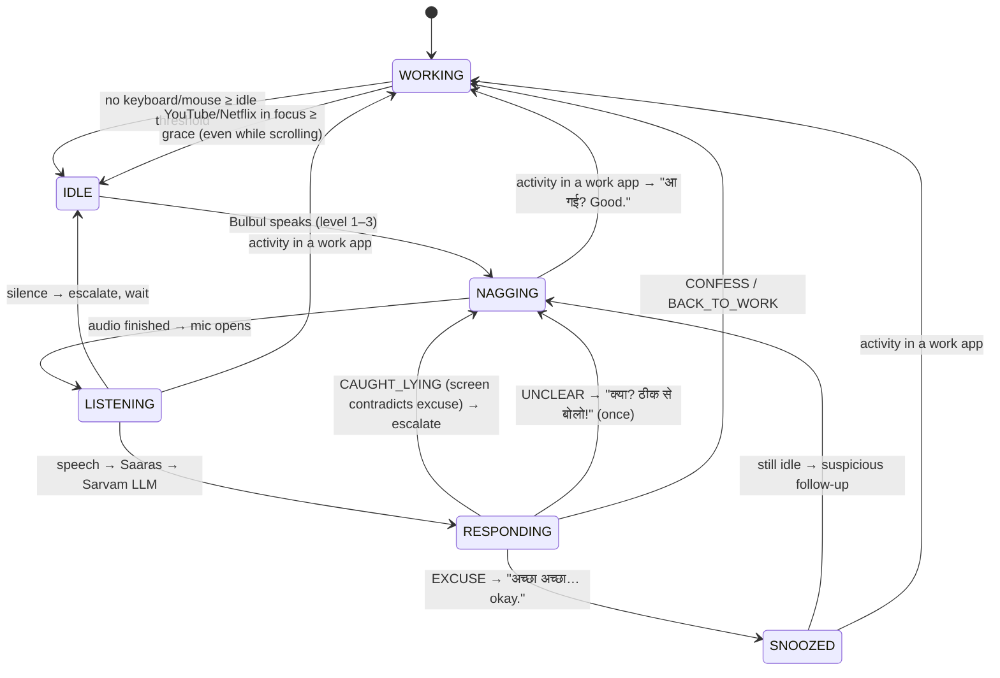

# Side Eye

*"मुझे पता है।"*

**A voice focus buddy for macOS. It catches you slacking, nags you in Hinglish, listens to your excuse, and talks back.**

**Website:** https://garimapahwa.github.io/side-eye · _Demo video: coming soon_ <!-- drop demo.gif / YouTube link here -->

```bash
# install (macOS, no admin password) — the eye icon appears in your menu bar
curl -fsSL https://garimapahwa.github.io/side-eye/install.sh | bash
```

Go idle while you're supposed to be working and an Indian mummy calls you out, out loud. Answer her ("nahi nahi, padh rahi hoon") and she *understands* you, stays suspicious, and comes back later asking whether that reading is done yet. Claim you're studying while Taarak Mehta is playing in Chrome and she checks your screen: *"पढ़ाई? Screen पे तो Taarak Mehta चल रहा है! मुझे सब पता है।"* Stay silent and she gets louder, faster and more dramatic. Get back to real work and she stops mid-sentence: *"आ गई? Good. काम करो।"*

Built for the **Sarvam Bulbul Build Challenge**. It uses only Sarvam AI models: **Bulbul v4 Flash** (voice), **Saaras v4** (speech-to-text) and **Sarvam-105B** (understanding + replies).

---

## Features

- **Talks and listens.** Spoken nags in natural Hinglish, and it understands your spoken reply (excuse, confession, "I'm back", or gibberish).
- **Sees what's on screen.** It reads the focused app and the active Chrome/Safari tab, names what you're watching, and catches lies. It works across a second monitor too.
- **Can't be fooled by mouse wiggling.** Scrolling YouTube counts as distraction. Only activity in a work app (VS Code, Terminal, docs…) counts as being back.
- **Escalates with voice prosody.** Three levels using Bulbul's pace, pitch and loudness: teasing → annoyed → *full drama*.
- **Seventeen characters.** Mummy, Papa, Dadi, Didi, a Gen-Z dost, a class teacher, a corporate boss, a filmy narrator, an action hero, a detective, a news anchor, a cricket commentator, and a Bollywood set (Angry Young Man, Romantic Hero, Bhai, Villain, Cricket Coach) that twists famous film dialogues into scoldings. All voices are Bulbul's own; no celebrity voices or names.
- **Lives in the menu bar.** An eye icon that starts with your Mac and stays until you quit. Click it for an on/off switch, a voice picker, how long you can stay idle before a reminder (8 seconds to 30 minutes; YouTube or Netflix in front of you is caught within 30 seconds), Launch at Login and Quit.
- **Fast.** The first audio plays in about 100–200 ms, and common lines are pre-cached so the first nag is instant.
- **Never goes silent.** If the LLM is slow or down, a local keyword classifier and built-in line banks take over.
- **Live terminal dashboard.** It shows state, idle and distraction timers, escalation level, what you said, detected intent, latency and a session tally.

## Requirements

- **macOS.** Idle and screen detection use macOS tools.
- **Python 3.11+**
- A **Sarvam AI API key**, free to start, from [dashboard.sarvam.ai](https://dashboard.sarvam.ai)
- Speakers and a microphone. The built-in ones work fine.

## Quick start

**Easiest:** run the one-line installer above. It sets up Python, downloads the app, asks for your key and puts **Side Eye.app** in `~/Applications`. Run it again to update; add `-s -- --uninstall` after `bash` to remove it.

**From source:**

```bash
# 1. Get the code
git clone https://github.com/garimapahwa/side-eye.git
cd side-eye

# 2. Create a virtual environment and install dependencies
python3.11 -m venv .venv
source .venv/bin/activate
pip install -r requirements.txt

# 3. Add your Sarvam API key
cp .env.example .env
#    open .env and set:  SARVAM_API_KEY=sk_...

# 4. Run it
python app.py     # menu bar app (eye icon + on/off switch)
python main.py    # or: terminal version with the full dashboard
```

Now take your hands off the keyboard and trackpad for 8 seconds. 

**Every new terminal window** needs `cd side-eye && source .venv/bin/activate` before `python main.py`. Without it you'll see `command not found: python`.

### macOS permissions (one-time)

| Prompt | Why | If you clicked "Don't Allow" |
|---|---|---|
| "Terminal would like to access the **Microphone**" | To hear your reply right after a nag | System Settings → Privacy & Security → Microphone → enable your terminal app |
| "Terminal wants to control **Google Chrome** / **Safari**" | To read the active tab's title and URL | System Settings → Privacy & Security → Automation → enable it under your terminal app |

No Accessibility or Screen Recording permission is needed.

## Try this

With `python main.py` running in demo mode:

1. **Go idle** (hands off for 8 s). Mummy catches you. If YouTube or Netflix is open, she names it.
2. When the badge says **LISTENING**, say *"nahi nahi, padh rahi hoon"*.
   - If a distraction is on screen, she busts the lie and gets louder.
   - Otherwise: *"अच्छा अच्छा… okay."*, then she comes back 12 s later, suspicious about your excuse.
3. Say *"sorry, phone chala rahi thi"*. She forgives you, and you're back to WORKING.
4. Go idle again and **say nothing**. She escalates L1 → L2 → L3.
5. **Scroll YouTube with the mouse.** It doesn't count: *"Scroll करना काम नहीं होता बेटा!"*
6. **Switch to VS Code and type.** *"आ गई? Good. काम करो।"*

Speak only after she finishes talking. The mic opens when the badge shows LISTENING.

## Usage

```bash
python main.py                         # mummy persona, demo timers
python main.py --persona dost          # Gen-Z best friend
python main.py --persona commentator   # cricket commentator
python main.py --mode real             # real-life timers (idle 7 min, snooze 10 min)
python main.py --no-screen             # don't look at the focused app / browser tab
python main.py --audition              # hear every candidate voice, pick by ear
MPH_LOG=1 python main.py               # write a text log to .cache/session.log
IDLE_THRESHOLD=15 python main.py       # override any timer (see table below)
```

Press **Ctrl+C** to quit.

### Personas

| `--persona` | Bulbul voice | Vibe |
|---|---|---|
| `mummy` (default) | `simran_hi_recovery` | Strict, dramatic, loving. *"मैंने इतनी मेहनत से पढ़ाया…"* |
| `dost` | `ishita_enhi_customer` | Gen-Z roast. *"Bro… seriously? Reels?"* |
| `filmy` | `anand_hi_documentary` (pitched down) | Deep, dramatic baritone. *"देवियों और सज्जनों… keyboard ख़ामोश है।"* |
| `action` | `shubh_hi_stories_dramatic` | Loud, table-thumping hero. *"बस! अब मैं table तोड़ दूँगा!"* |
| `commentator` | `ratan_hi_customer_expressive` | *"और ये गई focus boundary के पार! Phone ने एक और wicket लिया!"* |
| `papa` | `ashok_hi_character` | Few words, maximum disappointment. *"बस! अब मैं wifi का password बदल दूँगा!"* |
| `dadi` | `roopa_hi_companion` | Sweet emotional blackmail. *"अब तो मैं तेरी मम्मी को बता दूँगी!"* |
| `didi` | `sanchita_hi_social` | Bossy elder sister. *"Screenshot ले लिया है। Proof मेरे पास है।"* |
| `teacher` | `ritu_hi_edtech` | Class teacher. *"Diary में note लिख दूँ? Parents sign करेंगे।"* |
| `boss` | `aditya_hi_sales` | Corporate jargon. *"Hi, quick sync? Keyboard पे कोई activity नहीं दिख रही।"* |
| `news` | `simran_hi_news_breaking` | Breaking news. *"देश जानना चाहता है, phone क्यों?"* |
| `detective` | `mukul_hi_suspense` | Slow suspense. *"सन्नाटा… keyboard ख़ामोश… और एक phone, जो अभी भी गर्म है।"* |
| `angry` | `mahesh_hi_documentary` (pitched down) | Bollywood angry young man. *"आज मेरे पास laptop है, deadline है… तुम्हारे पास क्या है?"* |
| `romantic` | `rehan_hi_social` | Bollywood romantic hero. *"पलट… पलट… laptop की तरफ़ पलट!"* |
| `bhai` | `vipul_hi_social` | Bollywood bhai. *"थप्पड़ से डर नहीं लगता साहब… deadline से लगता है।"* |
| `villain` | `advait_hi_character` | Bollywood villain. *"Mogambo ख़ुश हुआ! Keyboard बंद, phone चालू। हा हा हा!"* |
| `coach` | `sumit_hi_conversational` | Cricket coach. *"सत्तर minute हैं तुम्हारे पास… Phone रखो।"* |

Voices are checked at startup. If Sarvam ever retires one, the app automatically picks the closest available voice (same language and style). To change a voice, edit `speakers` for that persona in `config.py`.

### Timers

| Timer | demo (default) | real | env var |
|---|---|---|---|
| Idle before she catches you | 8 s | 420 s | `IDLE_THRESHOLD` |
| Distraction in focus before she catches you | 8 s | 90 s | `DISTRACTION_GRACE` |
| How long the mic listens | 6 s | 8 s | `LISTEN_WINDOW` |
| Snooze after an excuse | 12 s | 600 s | `SNOOZE_DURATION` |
| Gap between escalations | 5 s | 60 s | `ESCALATION_GAP` |

A second excuse in a row halves the snooze. Env vars can also go in `.env`.

## How it works



1. **Idle detection.** Polls `ioreg -c IOHIDSystem` (HIDIdleTime): seconds since the last keyboard or mouse event. No keylogging.
2. **Screen check.** A background thread reads the focused app (`lsappinfo`) and, for Chrome or Safari, the active tab's title and domain (AppleScript). It's text only, with no screenshots. If the focused app looks innocent, it also checks open browser windows, so Netflix on a second monitor still counts.
3. **Nag.** Bulbul v4 Flash streams the line over HTTP. Playback starts on the first chunk and stops mid-word the moment you return to real work.
4. **Listen.** The mic opens only *after* she finishes speaking, so she never hears herself. An RMS voice detector stops recording 1.2 s after you stop talking.
5. **Understand.** Saaras v4 transcribes. One Sarvam LLM call gets your words plus what's on screen and returns `{"intent", "reply"}` in the persona's voice. An excuse that the screen contradicts becomes `CAUGHT_LYING`, but a lecture on YouTube is not a lie, and owning up ("sorry, Netflix dekh rahi thi") counts as a confession.
6. **Respond.** Excuses get a snooze and a follow-up (written and pre-synthesized *during* the snooze, so it plays instantly). Confessions get forgiven. Silence escalates.

### Sarvam models and why

| Job | Model | Why |
|---|---|---|
| Voice | **Bulbul v4 Flash** (`bulbul:v4-flash`), `POST /text-to-speech/stream` | First audio in about 100–200 ms, so the nag lands the moment you're caught. Escalation is pure prosody: pace / pitch / loudness go 1.0 / 0.0 / 1.0 → 1.15 / 0.1 / 1.6 → 1.3 / 0.2 / 2.2. It handles Hinglish natively: Hindi written in Devanagari and English in Latin ("Phone नीचे रखो!") sounds natural without SSML. |
| Ears | **Saaras v4** (`saaras:v4`, `mode=codemix`) | Returns code-mixed speech in the same script style Bulbul and the LLM expect: *"Sorry sorry phone चला रही थी।"* About 200–300 ms. |
| Brain | **Sarvam-105B Conversations** (`sarvam-105b-conversations`) | The real-time / voice-agent variant. JSON mode with reasoning disabled, about 200 ms per reply. A 4 s hard timeout falls back to the local keyword classifier. |

All API calls share one keep-alive `httpx` client, and rate limits (HTTP 429) are retried with exponential backoff and jitter.

## Troubleshooting

| Problem | Fix |
|---|---|
| `command not found: python` | Activate the environment first: `source .venv/bin/activate` (needed in every new terminal window). |
| `SARVAM_API_KEY missing` | Run `cp .env.example .env` and paste your key into `.env`. |
| No voice | Check the volume and the output device (System Settings → Sound). Pause any video that's playing. Run `python -m sarvam_client` to test the voice on its own. |
| She never catches me | Watch the **idle** bar on the dashboard. Any trackpad touch resets it. Keep your hands fully off for 8 s. |
| She doesn't hear my reply | Allow microphone access (see permissions above). Speak after she finishes, while the badge says LISTENING. Test with `python -m audio`. |
| She hears the TV / video | The mic picks up background audio. Use a quiet room, or headphones for the bot's voice. |
| She doesn't notice YouTube | Allow Automation access for Chrome/Safari. Run `python -m screen` to see what the app sees. |
| `compdef: command not found` on terminal start | Unrelated to this app (it's a shell plugin). Safe to ignore. |

Test each piece on its own:

```bash
python -m sarvam_client   # speaks one line, prints time-to-first-audio
python -m idle            # live idle seconds
python -m audio           # record yourself, then hear it back
python -m screen          # what the app sees (app + tab), flags distractions
```

## Website

The landing page lives in [`docs/`](docs) and is served by GitHub Pages: a one-screen `index.html` with the install command, and the installer `docs/install.sh`.

## Project layout

```
app.py            menu bar app: eye icon, switch, voices, remind after
controller.py     its non-UI side: settings, API key, on/off, voice and idle-time picks
engine.py         starts/stops the pipeline; voice validation and cache warm-up
main.py           terminal version with the rich dashboard
config.py         modes and timers, prosody levels, model IDs, personas
brain.py          state machine, intents, escalation, lie detection, TTS cache
sarvam_client.py  Bulbul streaming TTS, Saaras STT, LLM (timeouts, retries)
audio.py          interruptible streaming playback, mic recording + voice detection
idle.py           macOS idle time (HIDIdleTime)
screen.py         focused app + browser tab, distraction detection, background watcher
lines.py          fallback line banks per persona / intent / level
ui.py             rich live dashboard
```

The first nag lines and the "आ गई?" lines are synthesized once and cached in `.cache/`, keyed by text, voice and prosody.

## Privacy

- **What's read:** idle time (seconds since your last keyboard or mouse input), plus the focused app's name and the active browser tab's title and domain. No keystrokes, no screenshots, no browsing history. Turn the screen check off with `--no-screen`.
- **What's sent to Sarvam:** your recorded reply (for transcription) and, when you're caught, the app and tab title text (so the LLM can judge your excuse).
- **The mic** opens only right after a nag, for a few seconds, and closes as soon as you stop talking.
- **No audio of you is stored.** Only the bot's own voice lines are cached on disk. The optional `MPH_LOG=1` log stores text only.
